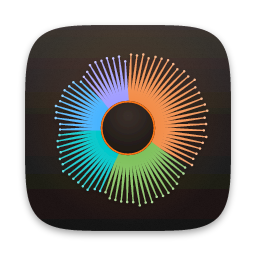
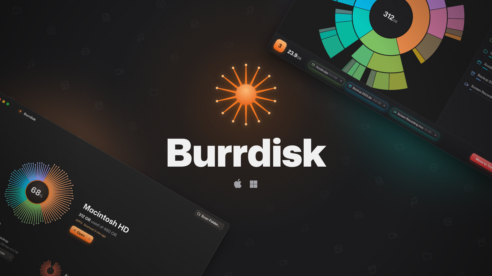
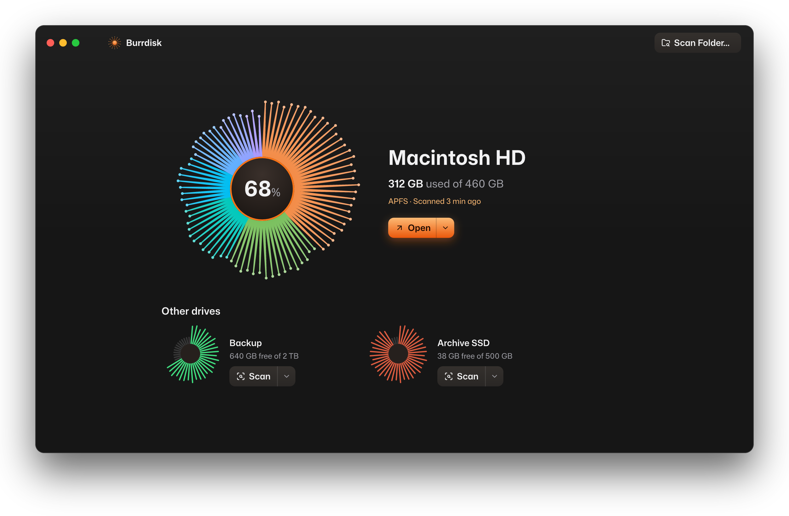
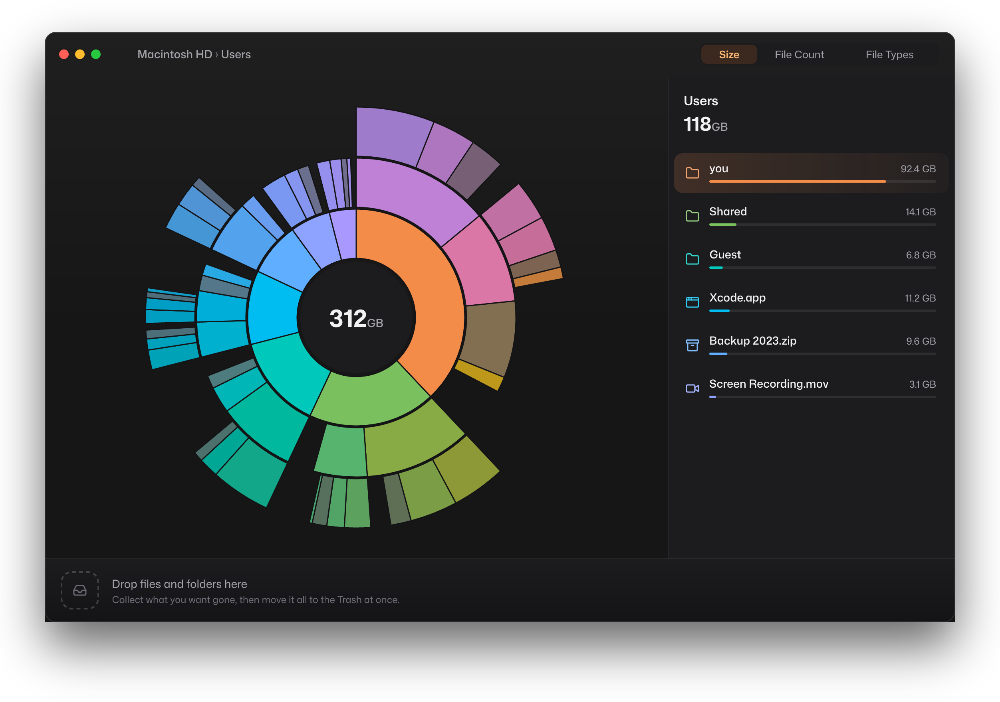
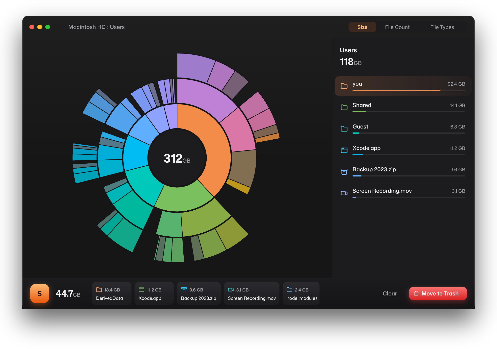

<p align="center">
  
</p>

<h1 align="center">Burrdisk</h1>

<p align="center">
  <strong>Dig right in. Free up your disk.</strong><br>
  A fast, friendly disk space visualizer for macOS and Windows.
</p>

<p align="center">
  <a href="https://github.com/bunkhq/burrdisk/releases/latest"></a>
  <a href="https://github.com/bunkhq/burrdisk/releases"></a>
  
  <a href="LICENSE"></a>
</p>

<p align="center">
  <a href="https://github.com/bunkhq/burrdisk/releases/latest"><strong>Download for macOS</strong></a>
  &nbsp;·&nbsp;
  <a href="https://github.com/bunkhq/burrdisk/releases/latest"><strong>Download for Windows</strong></a>
</p>

<p align="center">
  
</p>

## What it is

Burrdisk scans a disk or folder, shows you where the space went, and lets you clear it without fear of deleting the wrong thing.

Every disk is drawn as a burr, the prickly seed the app is named after. Its spines grow into the biggest folders on the disk. Open one and you get an interactive sunburst you can dive through. Anything you want gone goes into the Collector first. You review the pile, and then Burrdisk moves it all to the Trash (the Recycle Bin on Windows) in one go. Nothing is ever deleted permanently.

It is a native app written in Rust with [GPUI](https://gpui.rs), the GPU-accelerated UI framework behind the Zed editor. It opens instantly, and it stays smooth on disks with millions of files.

## Screenshots

<p align="center">
  
  <br><em>Pick a disk. Each burr shows how full the disk is, then grows into its biggest folders after a scan.</em>
</p>

<p align="center">
  
  <br><em>Explore. Click a ring to open a folder and the center to go back. The sidebar stays in sync.</em>
</p>

<p align="center">
  
  <br><em>Collect, then clean. Review everything you picked before it goes to the Trash.</em>
</p>

## Who it's for

- **Anyone who just got a "disk almost full" warning** and wants to know what is taking the space, without a terminal.
- **Power users and developers** who know that build folders, caches, `node_modules`, `DerivedData` and old disk images pile up, and want to find them fast.
- **Anyone careful about deleting things.** Every destructive step can be undone or stopped.

## How it works

1. **Pick a disk.** Home lists your disks, with the startup disk first and other drives below. Before a scan, each burr's spines show how full the disk is. The menu beside each Scan button can rescan (also as administrator), forget a scan, show the disk in Finder (File Explorer on Windows), or open Get Info (Properties). You can also scan any folder.
2. **Explore.** The scan shows live progress. The explorer then draws the disk as a sunburst. Each ring is one level deeper in the folder tree, and each slice is sized by the space it takes. You can color the chart by size, by file count or by file type. The sidebar lists everything in the current folder, largest first.
3. **Collect, then clean.** Drag files and folders from the chart or the list into the Collector at the bottom, or right-click one and pick **Move to Collector**. When the pile looks right, **Move to Trash** starts a 5-second countdown. **Stop** or `Esc` cancels it.

### What the numbers mean

- Sizes are the bytes a file takes on disk, not its length, so sparse and compressed files count correctly. Hard links are counted once.
- On the startup disk, space the scan can't see (snapshots, protected system files) shows as **Hidden space**. On macOS, give Burrdisk Full Disk Access in System Settings to see more.
- On Windows, files that OneDrive keeps online count only as the space they use locally. Hard links, which are common under `C:\Windows\WinSxS`, are counted at every path, so that folder can look larger than it is.
- On Windows, **Rescan as Administrator** asks for a UAC prompt. For a whole NTFS drive, it then reads the disk's file table directly instead of opening every folder. That is several times faster, and it also counts space that normal scans can't see, such as System Volume Information.

## Install

Download the latest version from [Releases](https://github.com/bunkhq/burrdisk/releases/latest).

**macOS** (Apple silicon): open `Burrdisk-<version>-arm64.dmg` and drag Burrdisk to Applications. The app is signed ad hoc, not notarized. The first time, right-click it and pick **Open**, or go to **System Settings > Privacy & Security** and click **Open Anyway**.

**Windows** (x64): run `Burrdisk-<version>-windows-x64-setup.exe`. It installs for your user without an administrator prompt, or for everyone if you choose. It adds Burrdisk to the Start menu, and you can remove it from **Settings > Apps**. The installer is not code signed, so SmartScreen may warn you first. Click **More info > Run anyway**.

### Updates

Burrdisk updates itself. It checks GitHub Releases a few seconds after launch and every six hours. On macOS you can also check from **Burrdisk > Check for Updates…**. When a new version is out, an Update button appears in the title bar. Nothing downloads until you click it.

**Update and Restart** downloads the new version and checks it against the SHA-256 digest that GitHub records for the file. Then it installs the update and reopens Burrdisk. On macOS, the new app replaces the old one in place. Because the app is signed ad hoc, you have to turn on Full Disk Access again after each update. On Windows, the new installer runs silently over the existing install.

## Privacy

Burrdisk has no accounts, analytics or telemetry. Scan results stay on your computer and are kept only for the session. The only network requests are the update checks to the GitHub Releases API, and update downloads when you ask for one.

## Keyboard

| macOS | Windows | Action |
| --- | --- | --- |
| `⌘[`, `⌘]` | `Ctrl+[`, `Ctrl+]`, `Alt+←`, `Alt+→` | Back up to the parent folder (or the disk list), and forward down the path you came back from |
| `Esc`, `⌫`, `⌘↑` | `Esc`, `Backspace`, `Ctrl+↑` | Go up a folder (or back to the disk list); stops a Trash countdown |
| `Space` | | Quick Look the hovered item (macOS only) |
| `⌘⌫` | `Ctrl+Backspace` | Move the hovered item to the Collector |
| `⌘Q` | `Alt+F4` | Quit |

The mouse's back and forward buttons step back and forward like the arrows in the title bar.

## Build from source

You need Rust 1.88 or later. On macOS you also need Xcode with the Metal Toolchain (`xcodebuild -downloadComponent MetalToolchain`).

```sh
cargo run --release              # open the disk picker
cargo run --release -- ~/Library # scan a folder directly
```

<details>
<summary>More build notes</summary>

- **Full Disk Access during development.** Use `script/dev-app.sh` instead of `cargo run`. It builds a `Burrdisk Dev.app` signed with a local certificate, which is created once in your login keychain, so the Full Disk Access grant survives rebuilds. The first time, run `script/dev-app.sh --grant` and add the app in System Settings.
- **Without Xcode.** Build with `--features runtime_shaders` to compile the Metal shaders at launch instead.
- **Testing the updater.** Builds that aren't installed (`cargo run`, `Burrdisk Dev.app`) don't check for updates. To try the updater, point a bundled `Burrdisk.app` at your own release JSON, in the shape of GitHub's `releases/latest` API: `BURRDISK_UPDATE_FEED=http://127.0.0.1:8000/release.json Burrdisk.app/Contents/MacOS/burrdisk`.
- **macOS bundle.** `script/bundle.sh` builds the release `Burrdisk.app` and packs it into a disk image and a zip in `dist/`.
- **Windows.** `cargo run --release` needs Visual Studio's C++ build tools and the Windows SDK. `script\bundle.ps1` builds the release `Burrdisk.exe`, its installer (with [Inno Setup 6](https://jrsoftware.org/isinfo.php)) and a portable zip in `dist\`.
- **Icons and artwork.** `script/icons/make_icons.py` draws the app icons. `script/icons/build.sh` renders them and packs `assets/macos/Burrdisk.icns` and `assets/windows/burrdisk.ico`. `script/promo/build.sh` renders the promotional covers in `assets/promo/`. Both need Python 3 and `cargo install resvg`.
- **Releases.** Pushing a `v*` tag runs `.github/workflows/release.yml`. It builds the disk image and the installer on GitHub's runners and attaches them to a draft release.

</details>

## Contributing

Bug reports and ideas are welcome in [Issues](https://github.com/bunkhq/burrdisk/issues). Please report security problems privately, as described in [SECURITY.md](SECURITY.md).

## License

Burrdisk is released under the [MIT License](LICENSE). It bundles the Mona Sans typeface (SIL Open Font License 1.1) and icons from Lucide (ISC License). See [THIRD_PARTY_NOTICES.md](THIRD_PARTY_NOTICES.md) for details.

macOS, Finder and Quick Look are trademarks of Apple Inc. Windows and OneDrive are trademarks of Microsoft Corporation. Burrdisk is not affiliated with or endorsed by either company.

<p align="center"><sub>Made with <a href="https://t3.codes">T3 Code</a>.</sub></p>
